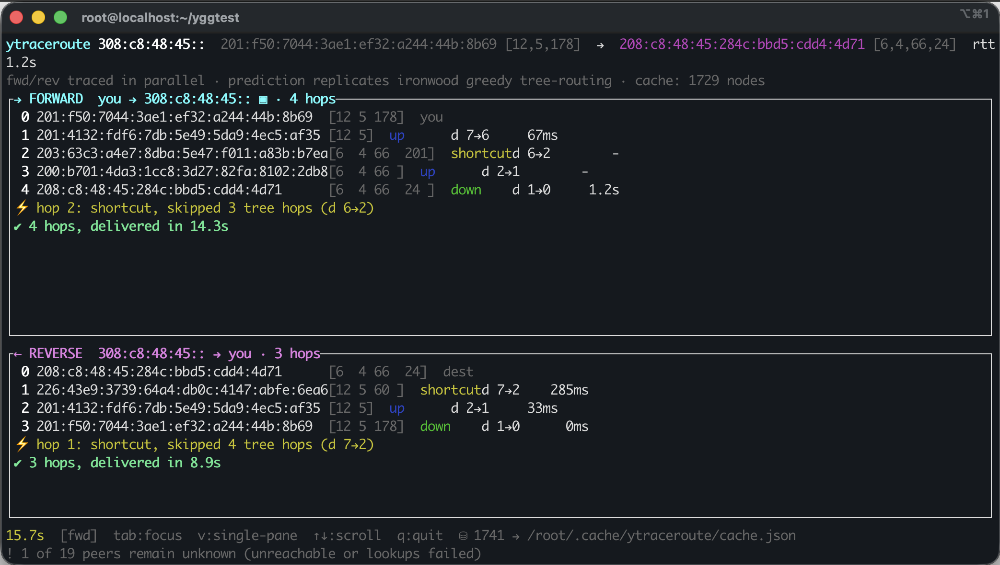
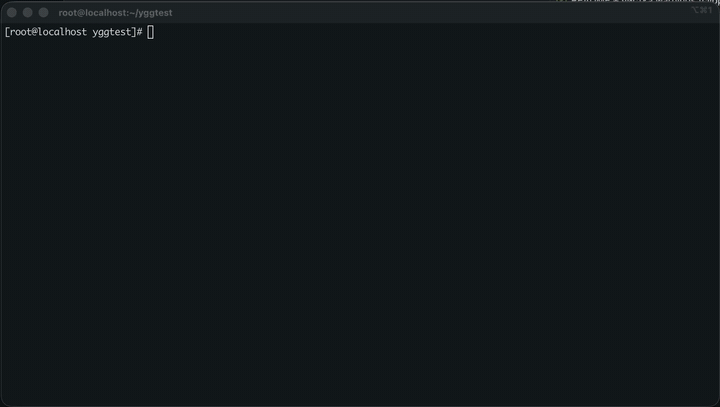

**English** | [Русский](README.md)

# ytraceroute


A predictive traceroute for Yggdrasil (v0.5.x) networks. Yggdrasil has no
TTL/echo mechanism, so a real traceroute is impossible — **ytraceroute
predicts** the packet's route by replaying ironwood's per-hop routing
decision (greedy routing in the spanning-tree metric) on topology data
collected from remote nodes through the admin API
(`debug_remoteGetSelf` / `debug_remoteGetPeers`).

Forward and reverse paths are traced **in parallel** — and they legitimately
differ: every node picks its next hop from its own RTT measurements and its
own snapshot of the tree. "Shortcuts" are not a separate mechanism: any
direct peer that is closer to the destination in the tree metric wins
automatically; ytraceroute finds them and shows how much the shortcut
shortened the route compared to the path through the root.



Demo: both routes building live — the speculative "via root" rows collapse
as hops and shortcuts confirm:



## Features

- live output: hops appear as async queries resolve;
- dual-pane TUI: forward and reverse, with the speculative "via root" route
  shown immediately and collapsed on the fly as hops confirm;
- output modes: TUI (terminal), stream (`--no-tui`, works over ssh without
  a terminal), NDJSON (`--json`);
- destinations: node IPv6 address (`02…`), routed subnet (`03…`), hex key or
  `self`; unknown addresses are resolved by probing through the overlay
  (UDP) + `getSessions`;
- persistent node cache (`~/.cache/ytraceroute/cache.json`): repeated and
  similar routes start from already-learned coordinates and peer lists;
- exit codes: `0` — all directions delivered, `1` — dead end, `2` — error.

## Usage

```
ytraceroute [OPTIONS] <DEST>

DEST: 308:62:45:62:: | 208:84:68:55:2f91:8484:8d60:2fca | <64 hex> | self

  -e, --endpoint      unix:///var/run/yggdrasil.sock (default), tcp://host:port
                      or a path; $YTRACEROUTE_ENDPOINT
      --no-reverse    forward path only
      --max-hops N    (64)
      --parallelism N concurrent admin requests (4)
      --timeout SECS  per-request timeout (8; the server caps debug_remote at 6)
      --deadline SECS overall limit (90)
      --nodeinfo      fetch nodeinfo for each confirmed hop
      --no-prefetch   disable peer-list prefetching
      --exact         always scan every peer (no hinted optimization)
      --cache-ttl SECONDS  (90)  --no-cache  --cache-file PATH
      --no-tui  --json  -v
```

Example (node with admin on tcp://127.0.0.1:9001):

```
$ ytraceroute -e tcp://127.0.0.1:9001 308:62:45:62::

→  1  201:4132:fdf6:7db:5e49:5da9:4ec5:af35  6fb34082…  [12,5]         up     d 4->3  67ms
→  2  226:36c5:a024:2e70:bac:4ce4:455:29    00000000…  [12]           up     d 3->2
→  3  218:71e5:78e4:8989:b71:db7f:7bf1:f1e1 000000c7…  [12,103]       down   d 2->1
→  4  208:62:45:62:59b8:f1a2:62ca:f87c     00ffceff…  [12,103,154]   down   d 1->0
✔ → forward: 4 hops, delivered
←  1  226:43e9:3739:64a4:db0c:4147:abfe:6ea6 00000000… [12,5,60]  shortcut d 4->2
← ⚡ hop 1: shortcut, skipped 1 tree hops (d 4→2)
…
✔ ← reverse: 3 hops, delivered
```

## How it works

1. **Bootstrap**: local `getSelf`/`getTree`/`getPeers`/`getPaths` plus the
   on-disk cache.
2. **Self coordinates**: a trick — `debug_remoteGetSelf` addressed to *our
   own* key makes the node run a path lookup for itself; the RPC itself
   times out honestly, but the coordinates show up in `getPaths`.
3. **Destination coordinates**: a `debug_remoteGetSelf(dest)` probe (also
   RTT and reachability); coordinates come from `getPaths` (signed by the
   node itself).
4. **Walk** (each direction): at node X take its peers
   (`debug_remoteGetPeers`), fire **fanout** probes at the unknown ones
   (fire-and-forget: the very act of sending makes our node learn the
   peer's path) and harvest everything with a single `getPaths`; then an
   exact replication of ironwood's `_lookup`: candidates must be strictly
   closer to the destination, `argmin(cost·dist)` with the original
   tie-breaks (dist → cost → deterministic lowest key), watermark strictly
   decreasing.
5. **Hinted probes**: only peers from the destination's view
   (`debug_remoteGetTree(dest)` = the keys of its `infos`: ancestry +
   peers + their ancestries) and from our own `getTree` are probed first —
   these are almost always the candidates. A full scan of a hub's peers
   kicks in only when no hinted candidate emerges (fallback); `--exact`
   always does the full scan. Important: transit nodes cache nothing about
   the destination (neither in `paths` — only the lookup initiator writes
   there — nor in `infos` — only peer ancestries land there), so "ping
   first and read node caches" does not work literally; prioritizing probes
   by the destination's view does.
6. **Dead end / moved target**: if there are no candidates or the
   destination's coordinates collide with another node, the target is
   re-learned (once) and the walk continues.

Link costs for our own links come from `getPeers` (ms) and only affect
the first hop; remote link costs are unknowable and default to the minimum
(1 ms) — with equal costs the decision falls to treespace distance.

**Confidence markers**: every hop is annotated — `?` (alternatives with
nearby dist existed, or unknown peers — real link costs decide) and `†`
(the choice was made blind, many unknown peers). A hop landing at dist 1,
or the delivery hop, is unmarked: nothing can be closer. Each direction
ends with an aggregate `route confidence: high/medium/low` (reasons:
press `d` in the TUI, or use `-v` in stream mode).

## Limitations

- This is a prediction, not a fact: remote link costs are unknown, node
  `infos` snapshots diverge while the tree rebuilds (eventual CRDT
  consistency), destination coordinates may change mid-trace (detected by a
  final re-probe).
- `debug_remote*` requires v0.5.x on remote nodes; server-side timeout 6 s;
  peer lists are MTU-truncated (~2000 keys).
- Resolving an address through the overlay probe only works where the
  ygg interface lives (run ytraceroute on the node itself); through a
  remote admin endpoint, pass a hex key.

## Building

Native:

```
cargo build --release
```

Cross (macOS arm64 → linux aarch64, static musl binary; `rust-lld` is
already in the toolchain, no external linker needed):

```
rustup target add aarch64-unknown-linux-musl
ln -s ~/.rustup/toolchains/*/lib/rustlib/aarch64-apple-darwin/bin/rust-lld ~/.cargo/bin/
# .cargo/config.toml:
#   [target.aarch64-unknown-linux-musl]
#   linker = "rust-lld"
#   rustflags = ["-C", "target-feature=+crt-static"]
cargo build --release --target aarch64-unknown-linux-musl
scp target/aarch64-unknown-linux-musl/release/ytraceroute root@vm:/root/yggtest/
```

## Layout

```
src/ygg.rs       keys, AddrForKey/SubnetForKey, coordinates, tree_dist
src/admin.rs     admin socket client (newline-JSON, pretty-printed reads, fire())
src/routing.rs   _lookup replica: candidates(), select_next(), classify()
src/model.rs     node cache (TTL, in-flight dedup, fanout learning)
src/persist.rs   on-disk cache (atomic writes, LRU)
src/walk.rs      per-direction walk state machine
src/app.rs       orchestration: bootstrap, dest resolution, speculative route
src/render/      TUI / stream / NDJSON
tests/           address vectors (captured from a live node), routing scenarios
```
